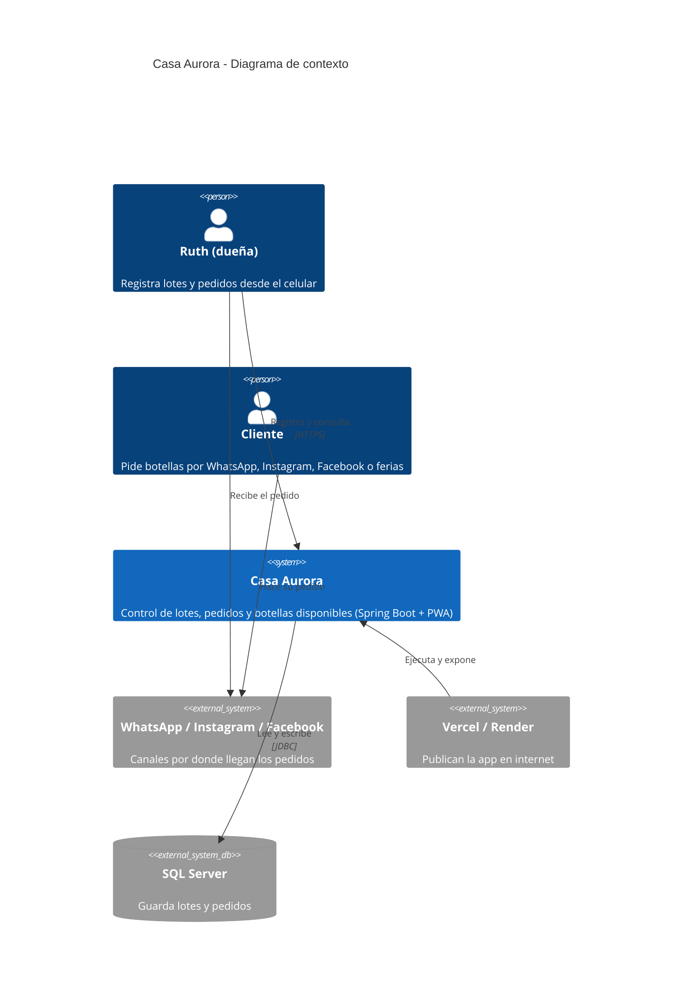
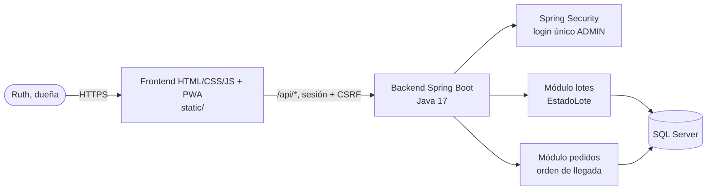

# Arquitectura de Casa Aurora

Sistema web para controlar lotes de vino de flor de Jamaica y los pedidos de la clienta (Ruth Daniela Rodríguez, Danlí, Honduras), asignándolos por orden de llegada.

## Diagrama C4 (contexto)

## Contenedores

## Decisiones

- [ADR-001: Persistencia](adr/ADR-001-persistencia.md)
- [ADR-002: Autenticación](adr/ADR-002-auth.md)
